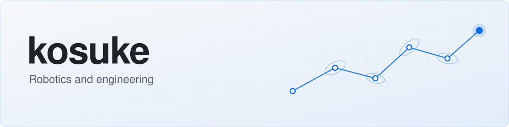
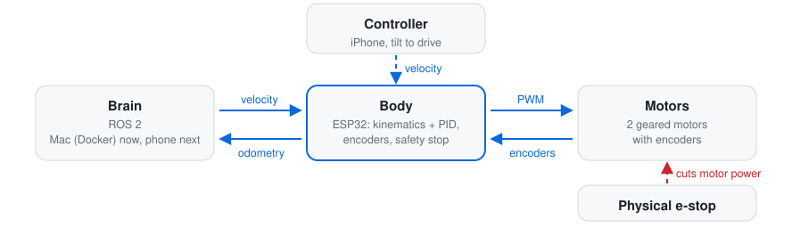
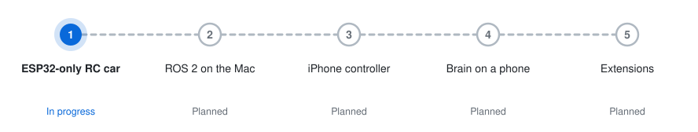
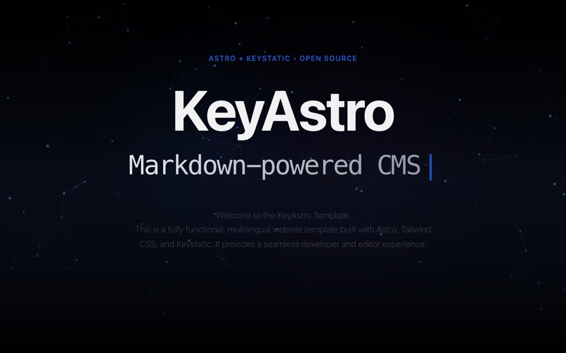
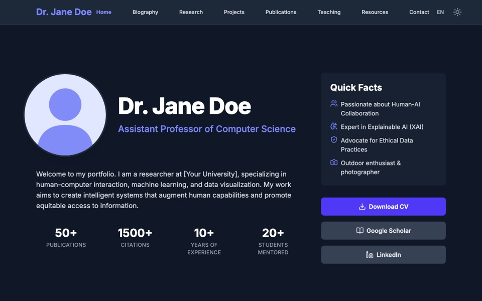
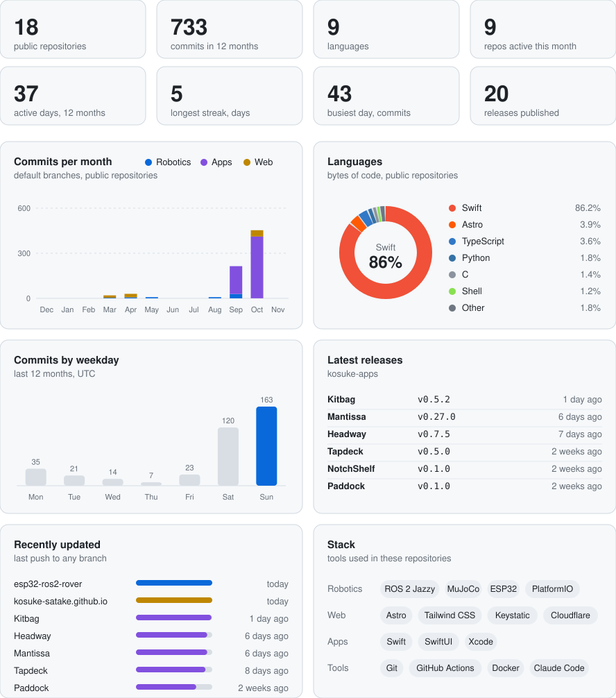

  <picture>
    <source media="(prefers-color-scheme: dark)" srcset="assets/banner-dark.svg">
    
  </picture>

## Robotics

### [esp32-ros2-rover](https://github.com/kosuke-satake/esp32-ros2-rover)

A low-cost differential-drive robot with an ESP32 body and a swappable ROS 2 brain, grown in stages toward vision,
SLAM, autonomous driving and natural-language interaction.

  <picture>
    <source media="(prefers-color-scheme: dark)" srcset="assets/rover-architecture-dark.svg">
    
  </picture>

  <picture>
    <source media="(prefers-color-scheme: dark)" srcset="assets/rover-roadmap-dark.svg">
    
  </picture>

[Source](https://github.com/kosuke-satake/esp32-ros2-rover) &nbsp;·&nbsp;
[Architecture](https://github.com/kosuke-satake/esp32-ros2-rover/blob/main/docs/architecture.md) &nbsp;·&nbsp;
[Roadmap](https://github.com/kosuke-satake/esp32-ros2-rover#roadmap)

### Learning workspaces

| | |
| --- | --- |
| [**ros2_ws**](https://github.com/kosuke-satake/ros2_ws) | A containerised ROS 2 Jazzy workspace that runs the same on a Mac and on an NVIDIA Linux laptop. |
| [**mujoco_ws**](https://github.com/kosuke-satake/mujoco_ws) | A step-by-step MuJoCo curriculum, from the basics to reinforcement-learning environments. |

## Web

Two open-source website templates that support multiple languages. Open a demo to try one.

<table>
  <tr>
    <td width="50%" valign="top"> <b><a href="https://github.com/kosuke-satake/keyastro">keyastro</a></b> A multilingual site with a blog, events and a CMS</td>
    <td width="50%" valign="top"> <b><a href="https://github.com/kosuke-satake/scholar-static">scholar-static</a></b> An academic portfolio with a built-in editor</td>
  </tr>
</table>

## Apps

Small, single-purpose apps for iPhone and Mac. The organization is the main place for them: details, downloads, privacy
notes and releases. Check [Kosuke Apps](https://github.com/kosuke-apps).

<table>
  <tr>
    <td width="33%" align="center" valign="top"><a href="https://github.com/kosuke-apps/Headway"> <b>Headway</b></a> Madison buses, live</td>
    <td width="33%" align="center" valign="top"><a href="https://github.com/kosuke-apps/Kitbag"> <b>Kitbag</b></a> A student's day in one app</td>
    <td width="33%" align="center" valign="top"><a href="https://github.com/kosuke-apps/Mantissa"> <b>Mantissa</b></a> Exact maths, offline</td>
  </tr>
  <tr>
    <td width="33%" align="center" valign="top"><a href="https://github.com/kosuke-apps/NotchShelf"> <b>NotchShelf</b></a> Menu bar items behind the notch</td>
    <td width="33%" align="center" valign="top"><a href="https://github.com/kosuke-apps/Paddock"> <b>Paddock</b></a> Menu bar control for local Ollama</td>
    <td width="33%" align="center" valign="top"><a href="https://github.com/kosuke-apps/Tapdeck"> <b>Tapdeck</b></a> Audio routing and recording</td>
  </tr>
</table>

## Sandbox

A playground for assorted apps built with AI. It is a sandbox, so things are fragile and break easily. Have a look if
you are curious: [Kosuke Sandbox](https://github.com/kosuke-sandbox).

## Activity

  <picture>
    <source media="(prefers-color-scheme: dark)" srcset="assets/dashboard-dark.svg">
    
  </picture>

